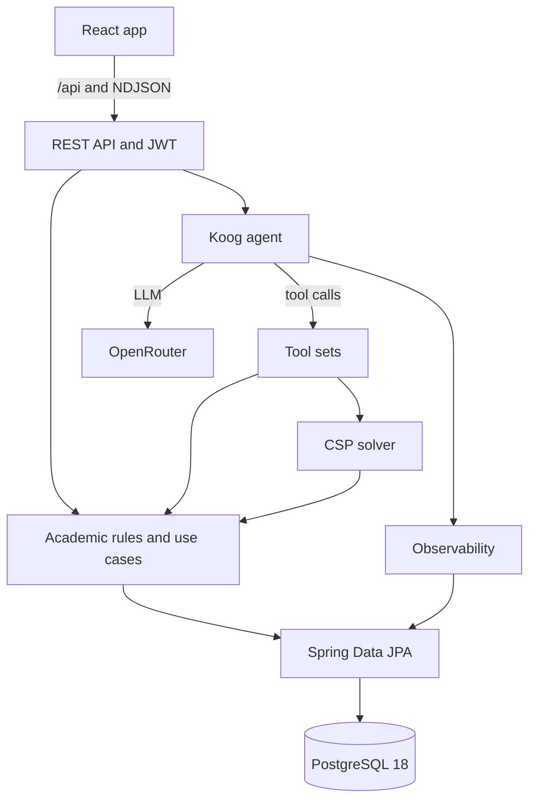

<div align="center">

# KRS Assistant

**A chat assistant for planning KRS at Ilmu Komputer, Universitas Sumatera Utara.**

[](https://kotlinlang.org/)
[](https://adoptium.net/)
[](https://spring.io/projects/spring-boot)
[](https://gradle.org/)
[](https://github.com/JetBrains/koog)
[](https://openrouter.ai/)
[](https://www.postgresql.org/)
[](https://react.dev/)
[](https://www.typescriptlang.org/)
[](https://vite.dev/)
[](https://tailwindcss.com/)
[](https://bun.sh/)
[](https://www.docker.com/)
[](./LICENSE)

</div>

A student logs in with their NIM, talks to the assistant, and gets a draft
*Kartu Rencana Studi* (KRS) that has already been checked against the
curriculum. The draft can be reviewed, edited, and submitted to the academic
advisor (Dosen PA).

This repository is the code behind my undergraduate thesis. The thesis claim is
that KRS planning can be modeled as a constraint satisfaction problem. The
language model does not choose the schedule. It reads the request, decides which
courses are required or optional, and explains the result. A deterministic
solver does the search and the validation.

## Contents

- [What it does](#what-it-does)
- [Stack](#stack)
- [How it works](#how-it-works)
- [Project layout](#project-layout)
- [Running it](#running-it)
- [Using the app](#using-the-app)
- [License](#license)

## What it does

- **Chat planning.** The student describes what they want to take. The assistant
  streams its reply and shows which tools it is calling.
- **CSP solver.** `solveKrs` builds the course and class combination. It uses
  AC-3, MAC, backtracking with MRV, and branch and bound. The LLM never invents a
  combination.
- **Validation.** Every draft is checked for schedule clashes, missing
  prerequisites, duplicate courses, the elective rule, practical courses that
  need their theory, the SKS quota, and the 8 SKS limit for D grades.
- **Partial drafts.** A draft does not have to fill every slot. Courses that
  cannot be placed are reported with a reason, and the rest can still be saved.
- **KHS.** Grades per semester, IP per semester, and cumulative IPK.
- **Manage KRS.** View the current draft, remove a course, print it, and submit
  it to the Dosen PA.
- **Monitoring.** Six pages for chat history, token usage, tool calls, solver
  runs, and evaluation results. All of them read from PostgreSQL.
- **Evaluation.** Ground truth cases, tool-call precision and recall, solver
  effort, and SUS/TAM questionnaire results.
- **Auth.** Login with NIM and password. The server issues a short-lived access
  token and an HttpOnly refresh cookie.

## Stack

### Server

- Kotlin 2.4.21, Java 25, Gradle 9.8.1.
- Spring Boot 4.1.1 with Spring Web MVC, Validation, Security, and Actuator.
- Spring Data JPA and Hibernate 7.4.5. Schema changes go through Flyway, not
  `ddl-auto`.
- Flyway 13.10.3 and PostgreSQL driver 42.7.14.
- Spring Security with java-jwt 4.6.2.
- Jackson 3 for JSON, kotlinx.serialization for DTO annotations.
- springdoc-openapi 3.1.1 for the OpenAPI file and Swagger UI.
- Ktor client 3.6.0, used only by the LLM client.

### Agent

- Koog 1.3.0 and koog-agents-additions 1.3.0-beta.
- OpenRouter with `anthropic/claude-haiku-5.5`.
- Prompt caching is enabled by a small HTTP client wrapper that adds Anthropic's
  `cache_control` field.
- The system prompt is split into nine Markdown files under
  `server/src/main/resources/prompt/`. The server picks one semester module
  (1 to 2, 3 to 5, or 6 to 8) and joins it with the universal modules.
- 18 tools across five tool sets: student info, KHS, courses, CSP solving, and
  KRS drafting.
- Tool calls, token usage, and solver runs are written to PostgreSQL.

### Solver

`KrsCspSolver` is a plain Kotlin class with no Spring or database dependency.

- Variables are courses that must be taken or may be taken.
- Domains are the class offerings in the active term that still have a free
  seat. Optional courses also have a `null` value, which means "skip".
- Unary constraints: prerequisites, minimum SKS, quota, and the KOM lock.
- Binary constraints: no schedule overlap. A class with a TBD schedule does not
  conflict with anything.
- Global constraints: total SKS, elective count, practical needs theory, MBKM
  cap, and the D-grade repeat rule.
- Search: AC-3, MAC, MRV, and branch and bound. The score is lexicographic:
  D shortfall, unlocked courses, required courses placed, total SKS, interest,
  then fewest KOM switches.

`AcademicRules` holds the numbers used by both the solver and the validator:
grade points, the IP-based SKS quota (24, 22, 20, 18, or 16), MKWU reservations,
the 8 SKS D limit, and time parsing. `SemesterContext` resolves the
administrative semester, the last graded semester, the MKWU slot, the elective
semester, and the D SKS counts.

### Frontend

- React 19.3.1 and TypeScript 7.0.
- Vite 8.3.4.
- Tailwind CSS 4.3.3. The portal uses a green and gold USU theme. Monitoring
  uses Material Design 3 surfaces and a navigation rail.
- React Router 7.18.4.
- Axios with automatic token refresh on 401. Streaming chat uses the native
  `fetch` API.
- react-markdown 10.1.0 and remark-gfm 4.0.1.
- goey-toast for notifications.
- Bun 1.4.3 for install, dev server, and build.
- oxlint for linting.

### Data and tooling

- PostgreSQL 18. The schema has 19 tables: academic data, chat history, tool
  calls, solver logs, evaluation cases and runs, and survey answers.
- Flyway runs on startup. Hibernate only validates the schema.
- The seeder is idempotent. It fills 71 courses, 748 class offerings, 40
  students, 51 curriculum packages, and 1,127 KHS rows. It also opens one active
  term.
- Docker Compose has separate development and production stacks.

## How it works

The server is split by feature: `academic`, `agent`, `auth`, and `core`.
Each feature has `presentation`, `domain`, and `data` packages. Spring
constructor injection connects them. The agent runs inside the server and calls
domain use cases through its tools, so the REST API and the agent use the same
business rules.



## Project layout

```text
KrA/
├─ app/                           React 19 client, built with Bun and Vite
│  ├─ Dockerfile                  Production image: Bun build, then nginx
│  ├─ Dockerfile.dev              Development image with Vite HMR
│  ├─ nginx.conf                  SPA fallback and streaming-safe /api proxy
│  └─ src/
│     ├─ api/                     HTTP clients, including the NDJSON chat stream
│     ├─ auth/                    Auth context, protected route, token storage
│     ├─ components/              Layout, chat, Markdown, monitoring components
│     ├─ pages/                   Login, dashboard, KHS, KRS, chat, monitoring
│     ├─ types/                   API types and UI types
│     └─ utils/
├─ server/                        Spring Boot backend, standalone Gradle build
│  ├─ Dockerfile                  Multi-stage build to a slim JRE image
│  ├─ Dockerfile.dev              Bind mount and ./gradlew bootRun
│  ├─ gradle/libs.versions.toml   Version catalog
│  └─ src/main/
│     ├─ resources/
│     │  ├─ application.yaml
│     │  ├─ db/migration/         Flyway V1 and V2
│     │  └─ prompt/               Nine prompt modules
│     └─ kotlin/id/andreasmlbngaol/kra/
│        ├─ ServerApplication.kt
│        ├─ academic/             Courses, KHS, KRS, curriculum, solver
│        ├─ agent/                Agent, tools, observability, evaluation
│        ├─ auth/                 Login, refresh, security
│        └─ core/                 Enums, errors, web config
├─ docker-compose.yml             Production stack
├─ docker-compose.dev.yml         Development stack
├─ .env.example                   Production env template
├─ .env.dev.example               Development env template
├─ LICENSE
├─ NOTICE
└─ CLAUDE.md                      Notes for coding assistants
```

## Running it

Both stacks run in Docker. You do not need a local JDK, Bun, or PostgreSQL.

### Requirements

- Docker Desktop, or Docker Engine with Compose v2.
- An OpenRouter API key. The server stops at startup if the key is empty.

### Configuration

Copy the template for the stack you want to run.

```shell
cp .env.example .env           # production
cp .env.dev.example .env.dev   # development
```

Then fill in `OPENROUTER_API_KEY`. For production, also set a long
`JWT_SECRET`.

| Variable | What it is | Default |
|---|---|---|
| `OPENROUTER_API_KEY` | OpenRouter key for the agent | empty, required |
| `JWT_SECRET` | Secret used to sign JWTs | `change-me...` |
| `JWT_ISSUER` | JWT issuer | `krs-server` |
| `JWT_AUDIENCE` | JWT audience | `krs-client` |
| `JWT_COOKIE_SECURE` | Send the refresh cookie only over HTTPS | `true` in prod, `false` in dev |
| `DB_NAME` | Database name | `kra_db` or `kra_db_dev` |
| `DB_USER` | Database user | `postgres` |
| `DB_PASSWORD` | Database password | `postgres` |
| `DB_PORT_HOST` | Host port for PostgreSQL | `5433` or `5434` |
| `SERVER_PORT` | Host port for the API in dev | `8081` |
| `WEB_PORT` | Host port for the web client | `80` or `5173` |
| `VITE_API_BASE_URL` | API base URL for the client | `/api` |

Compose sets `DB_URL` and the internal server port. The server always listens
on 8083 inside the network.

### Development

```shell
docker compose --env-file .env.dev -f docker-compose.dev.yml up
```

The server compiles on the fly, and Vite serves the client with hot reload.

| Service | URL |
|---|---|
| Web client | http://localhost:5173 |
| Monitoring | http://localhost:5173/monitoring |
| API | http://localhost:8081/api |
| Swagger UI | http://localhost:8081/swagger-ui.html |
| PostgreSQL | localhost:5434 |

### Production

```shell
docker compose up -d --build
```

| Service | URL |
|---|---|
| Web client | http://localhost |
| Monitoring | http://localhost/monitoring |
| API | http://localhost/api, proxied by nginx |
| PostgreSQL | 127.0.0.1:5433 |

The database is created and seeded on the first start. Data stays in the
`kra_pgdata18` volume.

PostgreSQL 18 puts its data directory in `/var/lib/postgresql/18/docker`, so the
compose files mount the volume at `/var/lib/postgresql`. Do not change it back
to `/var/lib/postgresql/data`.

Useful commands:

```shell
docker compose logs -f
docker compose down          # stop, keep data
docker compose down -v       # stop and delete the data volume
```

### Two stacks

The development and production stacks have different Compose project names,
volumes, and host ports, so both can run at the same time. Development mounts
the source and uses Vite HMR. Production builds the images and serves the client
with nginx.

## Using the app

1. Log in with NIM and password. The seeded account is `230001` with password
   `230001`.
2. Open **Informasi KHS** to see grades, IP, and IPK.
3. Open **Kelola KRS** to review the draft, remove a course, print it, or submit
   it to the Dosen PA.
4. Click the chat button at the bottom right to plan or change the KRS. The
   assistant shows each tool call and saves the draft only after validation.
5. Open `/monitoring` to inspect the agent:
   - **Ringkasan**: KPIs, recent activity, top tools, latest solver runs.
   - **Riwayat**: every chat turn with steps, duration, tokens, and model.
   - **Token**: token usage over time and per tool.
   - **Tool**: tool usage totals and a per-call log with arguments.
   - **Solver**: every solver run with nodes, backtracks, AC-3 revisions, and
     duration.
   - **Evaluasi**: ground truth cases, precision and recall runs, and SUS/TAM
     results.

## License

The code is licensed under the Apache License 2.0. See [LICENSE](./LICENSE) for
the full text and [NOTICE](./NOTICE) for the attribution notices.

If you redistribute this project or a modified version, section 4 of the license
requires you to keep the copyright and attribution notices and to include a
readable copy of `NOTICE`. Files you change must be marked as changed.

The project was written as an undergraduate thesis at the Department of Ilmu
Komputer, Universitas Sumatera Utara.

Copyright 2026 Andreas Manatar Lumban Gaol
